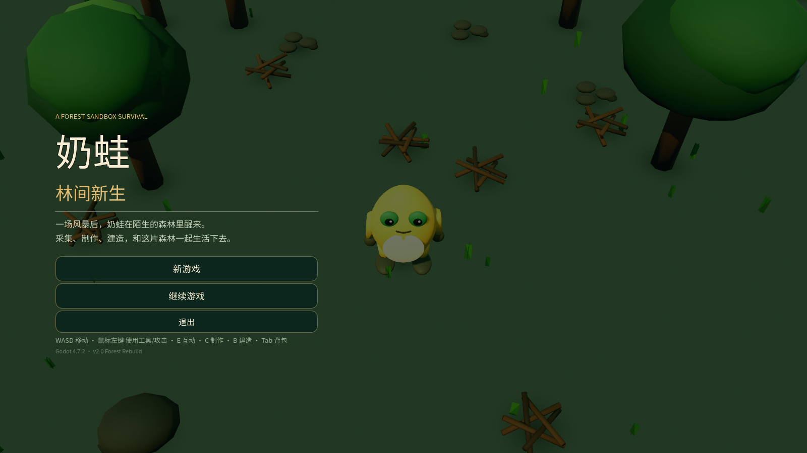

# 奶蛙：林间新生 / NAIFROG: WILDERNESS

3D 俯视角森林沙盒生存游戏，Godot 4.7 + GDScript，Blender 5.1 资产。
按 GDD《奶蛙：林间新生》从零重建，替换此前的海盗岛版本。



## 这是什么

一场风暴后，奶蛙在陌生森林里醒来。采集树枝与石头，制作第一把石斧，点燃营火，搭起木工台和床，在昼夜与天气变化中活下去，并深入北边的蘑菇林。

- 3D 俯视角，低多边形森林，程序化地形 + Blender GLB 资产
- 24 格背包 + 8 格快捷栏，8 个配方的制作系统
- 2m 网格建造：木地板、木墙、木门、斜屋顶、营火、储物箱、木工台、简易床
- 昼夜循环、晴朗/降雨/浓雾天气、饥饿/体力/生命
- 3 种森林敌人 + 古树守护者 Boss
- 7 步引导任务，可睡觉、死亡掉落、营地重生、存档/继续
- 完整的 Blender 资产：奶蛙骨骼+7 个动画、森林资源、建筑、敌人

## 操作

| 操作 | 按键 |
|---|---|
| 移动 | WASD / 方向键 |
| 冲刺 | Shift |
| 翻滚 | Space |
| 攻击 / 使用工具 | 鼠标左键 / J |
| 采集 / 交互 | E |
| 背包 | Tab / I |
| 制作 | C |
| 建造 | B |
| 快捷栏 | 1–8 |
| 暂停 | Esc |
| 建造旋转 / 拆除 / 取消 | R / X / 鼠标右键 |

靠近资源会显示交互提示。砍树需要石斧，挖岩石需要石镐；营地附近散落石块可以徒手捡。

## 运行

需要 Godot 4.7.2（GL Compatibility 渲染器）。

```powershell
godot --path . --editor
# 或直接运行
godot --path . -- --play
```

## 构建

Windows 与 Web 预设已包含在 `export_presets.cfg`。

```powershell
godot --headless --path . --export-release "Windows Desktop" "build/windows/NaiwaForest.exe"
godot --headless --path . --export-release "Web" "build/web/index.html"
```

当前构建产物：

- `build/windows/NaiwaForest.exe`
- `build/web/index.html`（同目录需要 `.pck`、`.wasm`、`.js`、`.png`）

Web 版本必须通过 HTTP 服务打开（不能直接双击 `index.html`）。仓库提供了一个带 COOP/COEP 头的本地服务器：

```powershell
python tools/serve_web.py 8080
# 浏览器打开 http://127.0.0.1:8080/index.html
```

## 测试

无头集成测试通过命令参数启动：

```powershell
godot --headless --path . -- --autotest
godot --headless --path . -- --loadtest
```

`--autotest` 覆盖移动、采集、背包、制作、任务推进、建造、睡觉、Boss 触发、玩家攻击、敌人死亡、死亡/重生、背包面板暂停行为和存档。
`--loadtest` 验证读档后的状态。

最近一次结果与已知限制见 [测试报告](docs/TEST_REPORT.md)。

## 资产管线

所有可编辑源文件在 `source_blend/`，导出 GLB 在 `assets/models/`。重建命令：

```powershell
blender --background --factory-startup --python tools/build_naifrog.py
blender --background --factory-startup --python tools/build_forest_assets.py
python tools/gen_music.py
```

- 奶蛙：`assets/models/frog/naifrog.glb`，骨骼动画 Idle / Walk / Run / Attack / Hit / Dodge / Death
- 环境：树、蘑菇丛、岩石、树枝堆、浆果灌木
- 建筑：地板、墙、门、屋顶、营火、箱子、木工台、床
- 敌人：史莱姆、蘑菇虫、尖刺兽、古树守护者

详细说明见 [资产管线](docs/ASSET_PIPELINE.md)。

## 目录

```
assets/          GLB 模型、字体、音频
scripts/         GDScript（core / data / player / world / building / enemies / ui）
scenes/          main.tscn
source_blend/    Blender 源文件（.gdignore，Godot 不导入）
tools/           可复现的 Blender / 音频 / 截图脚本
docs/            GDD、参考图、测试报告、资产管线
preview/         截图
```

## 当前限制

- 储物箱是 24 格共享容量的物品搬运箱，不是独立容器系统。
- 天气与篝火/火把有基础表现，但没有温度、湿度和农作物系统。
- 古树守护者已可触发和战斗，但还没有独立 Boss 血条 UI。
- Web 版本已成功导出并验证资源与页面可加载；本机无头浏览器截图只到 Godot 启动画面，建议在真实浏览器中再手动确认一次。
- Android 预设保留在配置中，但当前交付目标是 Windows 与 Web。

## 来源

- 设计依据：`docs/奶蛙沙盒生存游戏_完整游戏策划案_GDD与AI执行手册.docx`
- 角色参考：`docs/gdd_media/media_image1.jpg`
- 仓库：https://github.com/OStonefishO/NaiwaSurvival
